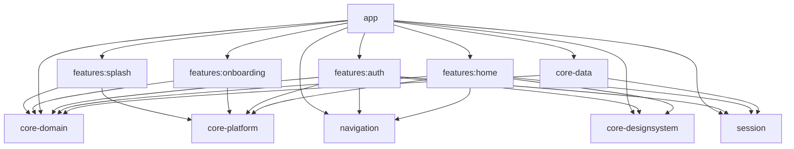

# Base de PagoControl

## Alcance implementado

Cuatro features: `splash`, `onboarding`, `auth` y `home`. Splash, los tres pasos del onboarding y Login/Registro/recuperación siguen las referencias de `docs/stitch_pagocontrol_android_app_ui`, adaptadas a los temas claro y oscuro. El acceso y el dashboard de PagoControl siguen siendo de demostración: no hay Firebase, servidor, lectura de SMS, permisos bancarios ni sincronización real.

Cuenta demo: `demo@pagocontrol.pe` / `PagoControl123`. El formulario permite completar estos datos con un botón. No usar credenciales personales. La contraseña no se guarda en disco ni en `SavedStateHandle`. La sesión sobrevive a recreaciones de Activity, pero termina al morir el proceso.

## Módulos y dependencias

La estructura toma como referencia `docs/skills/AndroidBase` y `docs/skills/android-modular/SKILL.md`. Los módulos compartidos están en la raíz, como en esa base:

```text
app/
buildSrc/src/main/kotlin/plugin/
core-domain/
core-data/
core-designsystem/
core-platform/
navigation/
session/
features/splash/
features/onboarding/
features/auth/
features/home/
```



| Módulo | Responsabilidad |
| --- | --- |
| `app` | Application, composición Koin, Activity, apariencia global y MainGraph |
| `core-domain` | Kotlin/JVM puro: validación, dashboard y contratos de repositorios |
| `core-data` | Implementaciones demo y preferencia de apariencia en DataStore |
| `navigation` | Kotlin/JVM puro: contratos de grafos y destinos serializables |
| `session` | Kotlin/JVM puro: identidad, resultado de acceso y contrato de autenticación |
| `core-platform` | BaseViewModel compartido por las features |
| `core-designsystem` | Tema Material 3, Manrope local, espaciados, componentes y formato PEN |
| `features:splash` | Lectura de preferencias de arranque, marca, carga, error y reintento |
| `features:onboarding` | Tres páginas, omitir/avanzar/volver y finalización persistente |
| `features:auth` | Login, Registro y recuperación con formularios y contratos independientes |
| `features:home` | Resumen, gráfico interactivo semanal/mensual, movimientos y logout |

No hay dependencias entre features. La UI depende de contratos; las implementaciones se seleccionan en Koin mediante `CoreDataModule`. Dominio, navegación y sesión se compilan sin Android. Navegación y sesión usan Koin Annotations/KSP para sus módulos, sin introducir dependencias de UI. Cada feature conserva `AuthGraph`/`HomeGraph` y `AuthModule`/`HomeModule` en su paquete raíz. La UI se organiza por pantalla: `auth/ui/login/`, `auth/ui/register/`, `auth/ui/forgotpassword/`, `splash/ui/splash/`, `onboarding/ui/onboarding/` y `home/ui/home/`. Los packages siguen esas carpetas; las pruebas reflejan la misma organización. Login separa `LoginUiState.kt`, `LoginUiIntent.kt` y `LoginError.kt`; Home separa `HomeUiState.kt`, `HomeUiIntent.kt` y `HomeContent.kt`. Los ViewModels contienen solo su lógica; cada contrato de nivel superior tiene su propio archivo. El ensamblaje global vive en `app/MainGraph.kt`; `MainActivity` solo configura la ventana y abre la app Compose.

## Inicialización e inyección

`AndroidApplication` es la Application registrada en el manifest. `onCreate` llama a `koinInitializer`, que ejecuta `startKoin`, registra `androidContext(this@AndroidApplication)`, habilita `androidLogger` y carga únicamente `AppModule().module`.

`AppModule` usa `@Module(includes = [CoreDataModule::class, NavigationModule::class, SessionModule::class, AuthModule::class, HomeModule::class, SplashModule::class, OnboardingModule::class])` y `@ComponentScan`. Cada feature expone su clase `@Module`/`@ComponentScan`; sus ViewModels se registran con `@KoinViewModel`. `CoreDataModule` proporciona los repositorios compartidos mediante funciones `@Single`, vinculadas a sus interfaces. El contexto inyectado es el de Application; los ViewModels conservan su lifecycle y no se registran como singletons.

`plugin.koin` centraliza KSP, Koin Annotations y el procesador. Se aplica en app, datos, navigation, session y mediante `plugin.feature` en las features. El catálogo fija KSP 2.3.11 y Koin Annotations/Compiler 2.2.0. Se deshabilita el módulo predeterminado con `KOIN_DEFAULT_MODULE=false`; no se combinan registros DSL con los módulos generados. `org.koin.ksp.generated.module` se importa en el arranque y el código generado no se edita.

## MVVM con flujo MVI

`ViewModel` es el propietario del estado de cada pantalla (MVVM). Las acciones entran exclusivamente por `onIntent`, que produce un `StateFlow<UiState>` inmutable para renderizar (MVI). Las pantallas reciben estado y callbacks; las entradas de grafo resuelven ViewModels mediante Koin y observan con `collectAsStateWithLifecycle`.

- Auth valida correo y longitud de contraseña; evita envíos duplicados, conserva el correo y permite reintentar. Una cuenta demo incorrecta nunca crea sesión.
- Home distingue carga, contenido, vacío y error; admite reintento, selección de periodo y barra, confirmación ilustrativa y logout.
- Las operaciones pertenecen a `viewModelScope`; cancelación se propaga y nunca se convierte en error de negocio.
- `core-platform/BaseViewModel` centraliza el StateFlow y su actualización atómica, siguiendo AndroidBase. Las intenciones, cargas, reintentos y políticas de concurrencia siguen siendo responsabilidad de cada feature.
- No se utiliza un canal de eventos para login/logout. La sesión es estado durable en memoria; `MainGraph` observa su identidad. Los avisos y diálogos permanecen en estado hasta ser descartados, evitando perder efectos al ir a segundo plano.

## Navegación y sesión

```text
SplashRoute.Graph / SplashRoute.Splash
  ├─ sesión válida → HomeRoute.Graph / HomeRoute.Home
  ├─ primera apertura → OnboardingRoute.Graph / OnboardingRoute.Welcome (3 pasos)
  └─ introducción completada → AuthRoute.Graph / AuthRoute.Login
Onboarding: Omitir / Iniciar sesión / Comenzar ahora → Login
AuthRoute.Graph: Login ↔ Register; Login ↔ ForgotPassword
Login / Register -- sesión real creada --> HomeRoute.Graph / HomeRoute.Home
HomeRoute.Graph / HomeRoute.Home -- cerrar sesión --> AuthRoute.Graph / AuthRoute.Login
```

Rutas tipadas mediante Kotlin Serialization y Navigation Compose. Cada feature registra su grafo; `app` coordina el cambio de sesión. Al cambiar de identidad, `popUpTo` inclusivo elimina el historial y los ViewModels de la sesión anterior; `launchSingleTop` evita duplicados. Si se restaura el grafo correcto al recrear la Activity, no se vuelve a navegar. Home no renderiza contenido sin sesión, incluso durante restauración. Atrás desde Home sale de la Activity y no vuelve al formulario; después de logout no permite recuperar el Home anterior.

Los otros destinos del diseño muestran un aviso de próxima etapa, sin crear features adicionales. La confirmación de notificación es ilustrativa y no cambia importes.

## Arranque, formularios y límites del prototipo

`StartupPreferences` tiene su contrato en dominio y su implementación en datos: DataStore `startup`, clave `onboarding_completed`, valor inicial false. Splash espera esa lectura y mantiene la marca 650 ms mediante una coroutine cancelable. No utiliza esperas bloqueantes. Los fallos muestran error y reintento sin borrar preferencias.

Onboarding guarda la página actual en `SavedStateHandle`. Omitir, entrar o finalizar persisten la finalización antes de navegar. Si la escritura falla, la pantalla permite reintentar; no salta el estado silenciosamente. La introducción completada no se repite después de logout ni al reiniciar el proceso.

Cada formulario tiene `Screen`, `ViewModel`, `UiState`, `UiIntent` y `Error` propios. Registro valida nombre, correo, contraseña de ocho caracteres y aceptación; recuperación valida correo. Se evitan envíos duplicados y las contraseñas no se guardan en SavedStateHandle ni DataStore.

`AccountRepository` separa los formularios del proveedor. PagoControl devuelve `DemoOnly`: no crea cuentas ni envía correos. AndroidBase usa un adaptador a su sesión, que permite registro y enlaces de recuperación de Firebase solo cuando ese modo está habilitado. El proveedor existente usa enlace por correo, por eso la UI no promete el OTP de seis dígitos de la referencia. El nombre del formulario de la plantilla no crea todavía un perfil remoto.

Google y huella muestran información de función pendiente. Los textos legales son marcadores de la plantilla. Las ilustraciones del onboarding son ejemplos; no afirman que ya existan lectores bancarios, cifrado Keystore ni sincronización. Las composiciones visuales se dibujan con Compose, sin depender de los HTML de Stitch en tiempo de ejecución.

## Diseño centralizado y apariencia

Todas las features usan el mismo `PagoControlTheme`, con paletas del `DESIGN.md`: amarillo de marca, fondo cálido claro y superficies oliva oscuras. No se habilita color dinámico para conservar la identidad. Manrope se empaqueta localmente, con pesos variables y números tabulares; su licencia está en `core-designsystem/src/main/assets/OFL-Manrope.txt`. Los colores semánticos se resuelven a través de MaterialTheme.

El menú de apariencia está disponible en Auth y Home: sistema, claro y oscuro. La preferencia es global al dispositivo, independiente de la sesión, y persiste en DataStore (`appearance`, clave `theme_mode`, valores `System`, `Light`, `Dark`). Valores ausentes/desconocidos usan el sistema. Un fallo de lectura IO ofrece el valor predeterminado sin sobrescribir el archivo; un fallo de escritura muestra un aviso. Se espera la primera lectura antes de dibujar las pantallas.

Se incluyen previews claras y oscuras, etiquetas accesibles, importes con signo, scroll, insets y adaptación al teclado. El contenido tiene ancho máximo en pantallas amplias. TalkBack, tablets y escalado extremo requieren una revisión manual adicional; no se certifica accesibilidad únicamente por previews.

## Build y stack

`buildSrc/src/main/kotlin/Config.kt` centraliza SDK 37, mínimo 24 y Java 21. Los scripts de `plugin/` proporcionan `plugin.application`, `plugin.android.lib`, `plugin.kotlin.lib` y `plugin.feature`, como en AndroidBase. `plugin.compose` extrae la configuración visual común entre features y designsystem; `plugin.feature` concentra las dependencias compartidas de las features. Cada módulo declara su namespace y las dependencias específicas que consume. El catálogo conserva versiones concretas: AGP 9.3.3, Gradle 9.5.0, Kotlin/Compose compiler 2.4.10, Compose BOM 2026.02.01, Navigation 2.10.0, Koin 4.2.2, coroutines 1.10.2 y DataStore 1.1.7.

Se usa Kotlin integrado de AGP en módulos Android; Kotlin JVM se aplica a dominio, sesión y navegación. Los plugins se cargan desde `buildSrc` con versiones del catálogo. Koin usa anotaciones y KSP con módulos por propietario y composición en `AppModule`. Se conserva la variante debug existente. Firebase, HTTP, sabores dev/prod y scripts de despliegue de la base no se incorporan; se mantienen los módulos y las capacidades de cada etapa.

Referencias oficiales consultadas: [Kotlin integrado de AGP](https://developer.android.com/build/migrate-to-built-in-kotlin), [Koin y Compose](https://insert-koin.io/docs/quickstart/android-compose/). La compatibilidad efectiva se verifica con el wrapper y las tareas del proyecto.

## Verificación reproducible

Requiere JDK 21, Android SDK 37 y `local.properties` con `sdk.dir` local. No contiene secretos ni archivos Firebase.

```powershell
.\gradlew.bat :app:assembleDebug
.\gradlew.bat :core-domain:test :core-data:testDebugUnitTest :features:auth:testDebugUnitTest :features:home:testDebugUnitTest :features:splash:testDebugUnitTest :features:onboarding:testDebugUnitTest
.\gradlew.bat :app:lintDebug
.\gradlew.bat :app:connectedDebugAndroidTest
```

Las pruebas locales cubren validación, sesión inválida, dashboard protegido, logout, doble envío, reintento y selección de periodo. La prueba instrumentada recorre acceso, Home, cambio a oscuro, recreación y dos sesiones consecutivas. Las pruebas usan implementaciones controladas; no acreditan un proveedor de autenticación real.

Validación inicial ejecutada el 8 de noviembre de 2026: APK debug generado; ocho pruebas unitarias aprobadas; dos pruebas instrumentadas aprobadas en Pixel 7, Android 16 (incluida la prueba de plantilla existente).

Tras migrar a `AndroidApplication` y Koin Annotations/KSP se ejecutaron nuevamente `:app:assembleDebug`, las seis pruebas unitarias de datos/Auth/Home, `:app:lintDebug` y las dos pruebas instrumentadas de `:app:connectedDebugAndroidTest`, todas correctamente. Se inspeccionó `AppModule` generado: incluye los tres módulos y registra el ViewModel de app sin duplicar las definiciones de las features. Lint finaliza con cero errores y veintidós advertencias; no se silencian checks ni se actualizan dependencias solo para eliminar avisos.

Se revisaron visualmente Auth claro y Home claro/oscuro en el emulador. Capturas locales en `app/build/screenshots/` y APK en `app/build/outputs/apk/debug/app-debug.apk`; son artefactos de build. No se ejecutó una auditoría manual completa con TalkBack ni la matriz de tablets/dispositivos antiguos.

## Próxima integración

Para autenticar cuentas reales, sustituir `DemoAuthRepository` en `CoreDataModule` por un adaptador de proveedor, implementar restauración/expiración de sesión y mapear errores al contrato. Sustituir `DemoHomeRepository` por datos de esa identidad. La UI de registro y recuperación ya está disponible; su proveedor real sigue pendiente en PagoControl. Configuración Firebase, permisos SMS y sincronización quedan fuera de este hito. Los datos demo no se migran a cuentas reales.

Skills aplicadas de `docs/skills`: android-modular, project-map, bootstrap, gradle-conventions, modularization, clean-domain, feature, mvi, navigation, koin, design-system, compose-ui, auth-session, coroutines, data-repositories, datastore, accessibility, unit-testing y ui-testing. Referencia de estructura: `docs/skills/AndroidBase`.

## Contratos de navegacion por feature

`navigation/route/` contiene los contratos de nivel superior `AppRoute`, `GraphRoute : AppRoute` y `DestinationRoute : AppRoute`, en ese orden y juntos en `AppRoute.kt`. `AuthRoute`, `HomeRoute`, `SplashRoute` y `OnboardingRoute` son interfaces selladas con objetos serializables anidados:

- `AuthRoute.Graph`: `Login`, `Register`, `ForgotPassword`.
- `HomeRoute.Graph`: `Home`.
- `SplashRoute.Graph`: `Splash`.
- `OnboardingRoute.Graph`: `Welcome` (tres pasos).

Cada feature usa su contrato en `navigation<FeatureRoute.Graph>` y `composable<FeatureRoute.Destino>`. `MainGraph` conecta estos grafos y conserva las reglas de sesion, restauracion y limpieza del historial. No hay rutas planas paralelas ni dependencias entre features.

`NavigationModule` y `SessionModule` se declaran con `@Module` y `@ComponentScan` y se incluyen explicitamente en `AppModule`. Son puntos de composicion de contratos compartidos; no registran rutas, modelos ni interfaces sin implementacion como singletons. Los repositorios concretos de sesion siguen registrados una sola vez en `CoreDataModule`. Los contratos, estados y modelos de sesion tienen archivos independientes.

Los flujos de Splash, Onboarding, Login, Registro y recuperacion se presentan en espanol, incluidos errores y apariencia, tambien cuando el sistema esta en ingles. Los recursos predeterminados `values/` son la fuente de estos textos; no hay traducciones inglesas activas para estos flujos. Splash utiliza un degradado adaptable al tamano con halo dorado superior/inferior y acento verde lateral, manteniendo contraste en ambos temas.

## Argumentos con nombre

En llamadas Kotlin con tres o mas argumentos suministrados, usa nombres explicitos para todos los argumentos dentro de los parentesis: `state = state`, `onIntent = viewModel::onIntent`, etc. Aplica tambien a constructores, inicializacion de propiedades/variables, previews, pruebas, grafos, pantallas y componentes compartidos. No cambia los nombres de los parametros declarados ni el comportamiento de la funcion.

Conserva la lambda final fuera de los parentesis cuando sea idiomatico en Compose; cuenta como argumento al decidir el umbral. En llamadas largas, especialmente pantallas desde los grafos, coloca un argumento por linea. Con uno o dos argumentos, los nombres son opcionales.

No fuerces nombres donde Kotlin no los admite (APIs Java o llamadas a valores de tipo funcion). Mantén los elementos `vararg` posicionales, como `listOf`, `arrayOf`, `FontFamily` o claves multiples de `LaunchedEffect`; no conviertas listas en arrays ni agregues adaptadores solo para cumplir la regla.

```kotlin
LoginScreen(
    state = state,
    onIntent = viewModel::onIntent,
    themeIndex = themeIndex,
    onThemeSelected = onThemeSelected,
    onRegister = onRegister,
    onForgotPassword = onForgotPassword,
)
```

## Ajuste visual de entrada

Splash sigue `splash_screen_pagocontrol_modo_oscuro`: fondo carbon con halos dorados y verde lateral, emblema de cartera dorado, distintivo PE, fuentes en capsulas y pie de privacidad sin prometer cifrado no implementado. El primer onboarding sigue `onboarding_1_detecci_n_autom_tica_modo_oscuro`, con tarjetas de ejemplo, iconos de proveedor morado/celeste y simbolos/etiquetas blancos en ambos temas. `EntryColors` centraliza esta paleta; los colores de proveedor admiten texto blanco con contraste >= 4.5:1, mientras el texto general se adapta al tema. Las tarjetas y etiquetas pueden envolver contenido y mantienen scroll.

Al terminar los tres pasos se guarda la preferencia y se abre Login, nunca Registro. Las pruebas verifican ese destino y el bloqueo de envios repetidos; Registro sigue disponible desde el acceso.

## Referencias oscuras de onboarding 2 y 3

Los pasos 2 y 3 incorporan `onboarding_2_privacidad_y_seguridad_modo_oscuro` y `onboarding_3_control_y_alertas_modo_oscuro` de Stitch. El segundo usa orbitas discontinuas, candado central, distintivos de fuentes de colores y tarjetas de privacidad. El tercero presenta saldo, Netflix, Luz del Sur y una tarjeta de ahorro con progreso. `PrivacyIllustration` y `ControlIllustration` estan en `ui/onboarding/components/`; ambos tienen previews claros y oscuros. Se conservan las etiquetas de ejemplo y no se afirman cifrado Keystore, funcionamiento offline o lectura SMS que aun no esten implementados. El ultimo boton sigue abriendo Login.
