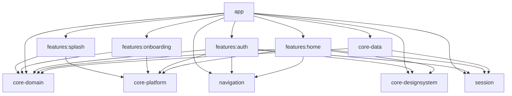

# Base de PagoControl

## Inicio con notificaciones locales

Inicio separa las secciones `HomeSection.Wallets` y `HomeSection.Mail`, seleccionables desde pestañas superiores mediante `SelectSection`. Billeteras presenta ingresos del mes actual y su cantidad en una tarjeta principal, sin saldo neto ni egresos. `Dashboard` conserva el historial original y añade series de ingresos (`weeklyIncomeFlow`, `monthlyIncomeFlow`) e historial de cobros (`receivedMovements`); el repositorio los calcula filtrando importes positivos antes de limitar los registros recientes. Esto evita que egresos reduzcan los gráficos de cobros o desplacen los cobros fuera del historial visible. Las filas existentes no se borran. Correo presenta un dashboard independiente con balance acumulado, ingresos y egresos del mes, monitoreo de Gmail, gráfico de cobros y transacciones recientes.

`GmailMonitoringRepository` define observación de dashboard, pendientes y estado de monitoreo, además de activación explícita. `RoomPaymentRepository` lo implementa con la misma base: el parámetro `mail` de las consultas segmenta por el paquete `com.google.android.gm`. La opción de Gmail usa la tabla de fuentes existente, se excluye del selector de Billeteras y no requiere migrar el esquema. `HomeViewModel` observa los dos canales con jobs y estados de error independientes. Confirmar un aviso Gmail admite importe positivo o negativo; los avisos de billeteras solo ofrecen ingreso en la UI.

`GmailTransactionCandidate` filtra notificaciones por paquete y palabras de transacciones en título/texto, normalizando tildes y mayúsculas. No autentica remitentes ni clasifica automáticamente los correos: cualquier candidato requiere revisión, incluidos mensajes ambiguos o promocionales que coincidan con el filtro. El servicio usa texto ampliado, texto simple o líneas disponibles; omite resúmenes de grupo para evitar convertir varios correos en una sola operación. No hay API de Gmail, OAuth ni importación de historial.

`GmailMonitoringCard` muestra el icono local, el interruptor persistente y estado activo solo con permiso de notificaciones y opción activada. Gmail no instalado/deshabilitado bloquea la activación. La selección de Gmail no modifica las apps monitoreadas en Billeteras. Los datos se conservan al pausar el monitoreo. Los tests verifican opt-in, reapertura, aislamiento de pendientes y totales, registro de egresos, filtro de candidatos y navegación entre secciones.

La etapa actual de Inicio sustituye el dashboard ilustrativo por Room. `PaymentNotificationListener` en app recibe nuevas notificaciones Android; `PaymentNotificationRepository` en dominio define captura, selección de fuentes, revisión y descarte. `RoomPaymentRepository` en core-data implementa ese contrato y `HomeRepository` con la misma base `payment_notifications.db`; Koin registra una sola instancia. `HomeViewModel` observa pendientes, fuentes y dashboard mediante Flow. La selección de apps se persiste en Room junto con el historial; DataStore conserva las preferencias generales existentes.

La captura solo persiste avisos de apps seleccionadas explícitamente o de Gmail si su interruptor está activado. Se omiten notificaciones de resumen de grupo y eventos permanentes. El usuario habilita el acceso especial de Android desde Inicio; volver de Ajustes actualiza el estado visible. No se importa historial anterior ni se consultan APIs bancarias.

`AutomaticYapePayment` reconoce ingresos nuevos del paquete `com.bcp.innovacxion.yapeapp`, título «Confirmación de Pago» y plantilla completa «[nombre] te envió un pago por S/ [importe]», con código de seguridad opcional. Es una regla determinista en dominio basada en el texto observado en el dispositivo real, con normalización de tildes, mayúsculas y espacios. Los importes ambiguos y formatos no reconocidos permanecen pendientes; no se infiere una operación a partir de un importe aislado. El repositorio persiste los reconocidos con estado `automatic` e importe positivo en la misma inserción transaccional que verifica la selección de la app. No cambia el esquema ni reinterpreta filas existentes.

Los demás avisos requieren confirmar importe en céntimos y dirección del movimiento. Confirmación y descarte solo modifican filas pendientes, por lo que repetir una acción no duplica movimientos ni altera registros automáticos. Se deduplican entregas con la misma clave Android y fecha de publicación; la reconciliación entre distintas apps queda pendiente. El dashboard observa estados `confirmed` y `automatic`, muestra el remitente sin etiqueta de lectura automática y calcula sus totales con ambos.

`AppMonitoringCard` presenta «Elegir apps a monitorear» y una fila horizontal de apps seleccionadas con sus iconos reales. Un selector inferior permite buscar y seleccionar apps tocando la fila completa. Nombres e iconos se cargan con PackageManager en IO y se actualizan al volver a la pantalla; se dispone de un icono de respaldo si una app no está disponible. El permiso solo se solicita visualmente si falta; el aviso de Gmail queda dentro del selector. `PendingNotificationCard` conserva la revisión de avisos ambiguos en un componente separado.

Los datos pertenecen al dispositivo y se conservan al cambiar la cuenta; la UI lo indica. El login Firebase sigue vigente para acceder a las pantallas, pero esta captura y persistencia no utilizan Firestore. La base está excluida del respaldo automático en la nube. Movimientos y Reportes continúan con datos ilustrativos propios hasta su integración. Las notas inferiores sobre Home demo corresponden a la etapa inicial.

Pruebas de esta etapa: `PaymentAmountTest`, `AutomaticYapePaymentTest` (formato observado, importe, remitente y rechazo de formatos ambiguos), `HomeViewModelTest`, `PaymentNotificationsTest` (selección, ingreso automático de Yape, duplicados, confirmación, descarte y reapertura de Room) y `HomeNotificationUiTest` (revisión de mensajes pendientes). La entrega de notificaciones bancarias reales requiere validación manual con las apps instaladas y el acceso habilitado.

## App y Auth con Firebase

La implementación vigente de autenticación y arranque se documenta en [FIREBASE_SETUP.md](FIREBASE_SETUP.md). Sustituye el acceso sin credenciales de la primera etapa: ahora se usan Firebase Authentication, perfiles Firestore, casos de uso y errores tipados dentro de `features:auth`, límite persistente de intentos y sesión restaurable. `app` inicializa Timber, Analytics/Crashlytics, App Check y Koin siguiendo AndroidBase. La UI de PagoControl se conserva; Google y huella siguen pendientes. Las notas inferiores de acceso demo describen la etapa inicial, no el proveedor de autenticación actual.

## Reportes financieros y navegación principal

`features:reports` implementa las referencias `reportes_financieros_modo_claro` y `reportes_financieros_modo_oscuro` con la identidad visual de PagoControl. Incluye balance neto, comparación con el período anterior cuando hay datos, tasa de ahorro calculada, ingresos/egresos, gráfico interactivo, seis categorías, cuatro canales y suscripciones recurrentes. El período se puede cambiar entre noviembre, últimos tres meses, año y un rango personalizado de meses de 2023.

Los datos de reportes son ilustrativos y están contenidos en la feature. Noviembre reproduce los importes del diseño; las distribuciones por categoría, canal y período conservan los totales en céntimos. No se afirma sincronización bancaria ni lectura de notificaciones. Los gráficos y las exportaciones utilizan el mismo resumen seleccionado.

`ReportsGraph`, `ReportsModule`, `ReportsViewModel`, estado e intenciones siguen el patrón de las demás features. `ReportsRoute` define el grafo y su destino protegido. La aplicación ensambla la navegación y limpia su estado guardado al cerrar sesión.

`PagoDock` ofrece únicamente Inicio, Movimientos, Reportes y Perfil, sin botón central de agregar. Las cuatro secciones se conectan desde app, con selección y restauración de estado entre pestañas.

La descarga abre el selector de documentos de Android. `AndroidReportExporter` genera archivos PDF, Excel OOXML (.xlsx) y CSV UTF-8 en la ubicación elegida, sin permisos de almacenamiento generales ni nuevas bibliotecas de documentos. La exportación conserva el período/formato capturados al abrir el selector y permite cancelar o reintentar. Los archivos indican que contienen datos de demostración y no constituyen libros tributarios ni formatos oficiales para SUNAT.

Las pruebas del módulo verifican los importes de noviembre, conservación de totales en todos los rangos, filtros, selección de barras y cancelación/error/concurrencia de exportación. `ReportsExportTest` verifica PDF, CSV y los XML del archivo Excel en Android. `AuthHomeFlowTest` recorre las cuatro secciones, la recreación de Reportes y la ausencia del botón de agregar.

## Perfil y preferencias

`features:profile` incorpora Perfil, Centro de ayuda y Privacidad a partir de las capturas proporcionadas. Usa la paleta, Manrope, tarjetas redondeadas, header y dock compartidos de PagoControl en claro y oscuro, sin planes ni suscripciones. Incluye edición local de nombre/correo, selector global de apariencia, idioma disponible (español), preferencia de notificaciones, preguntas desplegables, valoración de 1 a 5 estrellas con comentario de hasta 500 caracteres y confirmación de cierre de sesión.

`ProfileRoute` define Graph, Profile, Help y Privacy. La feature conserva su módulo Koin y los contratos de estado/intenciones/ViewModel. Los tres destinos están protegidos por sesión; Inicio, Movimientos y Perfil se conectan desde app sin dependencias entre features. Al salir se limpian los estados de navegación guardados de los módulos autenticados.

`ProfileRepository` vive en dominio y `DataStoreProfileRepository` en datos. Las preferencias se separan por identificador de usuario; la apariencia continúa usando el repositorio global existente. Los cambios del nombre/correo personalizan también el saludo de Inicio mediante la sesión observada por `AuthSessionViewModel` en `MainGraph`. Los errores de escritura permiten reintentar; las operaciones evitan envíos duplicados.

Las notificaciones son una preferencia local para la futura integración: no solicitan permisos ni habilitan lectura bancaria. La valoración se guarda localmente y no se envía a Google Play ni a un servidor. El selector de idioma indica que actualmente solo está disponible español. Ayuda y Privacidad describen estas capacidades reales del prototipo y no contienen enlaces o servicios ficticios.

Validación del módulo: `:features:profile:testDebugUnitTest`, `:features:profile:lintDebug` y `:app:assembleDebug`. La prueba instrumentada `AuthHomeFlowTest` cubre el acceso, los módulos autenticados, cambio de apariencia, persistencia de notificaciones tras recrear Activity, ayuda, privacidad, valoración y cierre de sesión.

## Movimientos e historial

`features:movements` implementa las referencias `movimientos_historial_modo_claro` y `movimientos_historial_modo_oscuro` con búsqueda, filtros combinables por tipo, fuente, estado y mes, balance mensual y tarjetas agrupadas por fecha. Incluye revisión y categorización local de pendientes, detalles y exportación mediante el menú de compartir de Android. Los ocho registros son ejemplos de noviembre de 2023; no existe sincronización real ni historial adicional. El balance mensual reproduce los totales ilustrativos de la referencia y permanece independiente de los filtros de la lista.

La feature mantiene `MovementsGraph`, `MovementsModule`, ViewModel, estado e intenciones propios. `MovementsRoute` define su grafo y destino tipados; `MainGraph` protege ambos grafos autenticados y conecta Inicio con Movimientos sin dependencias entre features. Atrás o Inicio regresa al dashboard.

`PagoHeader` y `PagoDock` viven en `core-designsystem` y se comparten entre las pantallas principales. El header conserva la marca y el subtítulo; la acción de notificaciones es opcional y se omite en Perfil. La apariencia se selecciona desde el acceso o desde Perfil; los controles de apariencia y cierre de sesión ya no aparecen en el header de Inicio. El dock identifica la sección activa con un indicador amarillo, un icono relleno y una etiqueta en negrita.

Las pruebas de Movimientos verifican filtros combinados, búsqueda por monto, separación de transferencias, mes vacío, restablecimiento y categorización de pendientes. `AuthHomeFlowTest` recorre acceso en oscuro, navegación entre Inicio y Movimientos y recreación de la Activity.

## Alcance implementado

Cuatro features: `splash`, `onboarding`, `auth` y `home`. Splash, los tres pasos del onboarding y Login/Registro/recuperación siguen las referencias de `docs/stitch_pagocontrol_android_app_ui`, adaptadas a los temas claro y oscuro. El acceso y el dashboard de PagoControl siguen siendo de demostración: no hay Firebase, servidor, lectura de SMS, permisos bancarios ni sincronización real.

El botón Iniciar sesión abre Home directamente con una sesión local de ejemplo, sin completar correo ni contraseña. No hay autocompletado ni tarjeta demo bajo el formulario. No usar credenciales personales: este acceso local no autentica una cuenta real. La contraseña no se guarda en disco ni en `SavedStateHandle`. La sesión sobrevive a recreaciones de Activity, pero termina al morir el proceso.

## Módulos y dependencias

La estructura toma como referencia `docs/skills/AndroidBase` y `docs/skills/android-modular/SKILL.md`. Los módulos compartidos están en la raíz, como en esa base:

```text
app/
buildSrc/src/main/kotlin/plugin/
core-domain/
core-data/
core-designsystem/
core-platform/
navigation/
session/
features/splash/
features/onboarding/
features/auth/
features/home/
```



| Módulo | Responsabilidad |
| --- | --- |
| `app` | Application, composición Koin, Activity, apariencia global y MainGraph |
| `core-domain` | Kotlin/JVM puro: validación, dashboard y contratos de repositorios |
| `core-data` | Implementaciones demo y preferencia de apariencia en DataStore |
| `navigation` | Kotlin/JVM puro: contratos de grafos y destinos serializables |
| `session` | Kotlin/JVM puro: identidad, resultado de acceso y contrato de autenticación |
| `core-platform` | BaseViewModel compartido por las features |
| `core-designsystem` | Tema Material 3, Manrope local, espaciados, componentes y formato PEN |
| `features:splash` | Lectura de preferencias de arranque, marca, carga, error y reintento |
| `features:onboarding` | Tres páginas, omitir/avanzar/volver y finalización persistente |
| `features:auth` | Login, Registro y recuperación con formularios y contratos independientes |
| `features:home` | Resumen, gráfico interactivo semanal/mensual, movimientos y logout |

No hay dependencias entre features. La UI depende de contratos; las implementaciones se seleccionan en Koin mediante `CoreDataModule`. Dominio, navegación y sesión se compilan sin Android. Navegación y sesión usan Koin Annotations/KSP para sus módulos, sin introducir dependencias de UI. Cada feature conserva `AuthGraph`/`HomeGraph` y `AuthModule`/`HomeModule` en su paquete raíz. La UI se organiza por pantalla: `auth/ui/login/`, `auth/ui/register/`, `auth/ui/forgotpassword/`, `splash/ui/splash/`, `onboarding/ui/onboarding/` y `home/ui/home/`. Los packages siguen esas carpetas; las pruebas reflejan la misma organización. Login separa `LoginUiState.kt`, `LoginUiIntent.kt` y `LoginError.kt`; Home separa `HomeUiState.kt`, `HomeUiIntent.kt` y `HomeContent.kt`. Los ViewModels contienen solo su lógica; cada contrato de nivel superior tiene su propio archivo. El ensamblaje global vive en `app/MainGraph.kt`; `MainActivity` solo configura la ventana y abre la app Compose.

## Inicialización e inyección

`AndroidApplication` es la Application registrada en el manifest. `onCreate` llama a `koinInitializer`, que ejecuta `startKoin`, registra `androidContext(this@AndroidApplication)`, habilita `androidLogger` y carga únicamente `AppModule().module`.

`AppModule` usa `@Module(includes = [CoreDataModule::class, NavigationModule::class, SessionModule::class, AuthModule::class, HomeModule::class, SplashModule::class, OnboardingModule::class])` y `@ComponentScan`. Cada feature expone su clase `@Module`/`@ComponentScan`; sus ViewModels se registran con `@KoinViewModel`. `CoreDataModule` proporciona los repositorios compartidos mediante funciones `@Single`, vinculadas a sus interfaces. El contexto inyectado es el de Application; los ViewModels conservan su lifecycle y no se registran como singletons.

`plugin.koin` centraliza KSP, Koin Annotations y el procesador. Se aplica en app, datos, navigation, session y mediante `plugin.feature` en las features. El catálogo fija KSP 2.3.11 y Koin Annotations/Compiler 2.2.0. Se deshabilita el módulo predeterminado con `KOIN_DEFAULT_MODULE=false`; no se combinan registros DSL con los módulos generados. `org.koin.ksp.generated.module` se importa en el arranque y el código generado no se edita.

## MVVM con flujo MVI

`ViewModel` es el propietario del estado de cada pantalla (MVVM). Las acciones entran exclusivamente por `onIntent`, que produce un `StateFlow<UiState>` inmutable para renderizar (MVI). Las pantallas reciben estado y callbacks; las entradas de grafo resuelven ViewModels mediante Koin y observan con `collectAsStateWithLifecycle`.

- Auth permite acceso directo en el proveedor local; los proveedores reales conservan validación de correo/contraseña. Evita envíos duplicados, conserva el correo y permite reintentar.
- Home distingue carga, contenido, vacío y error; admite reintento, selección de periodo y barra, confirmación ilustrativa y logout.
- Las operaciones pertenecen a `viewModelScope`; cancelación se propaga y nunca se convierte en error de negocio.
- `core-platform/BaseViewModel` centraliza el StateFlow y su actualización atómica, siguiendo AndroidBase. Las intenciones, cargas, reintentos y políticas de concurrencia siguen siendo responsabilidad de cada feature.
- No se utiliza un canal de eventos para login/logout. La sesión es estado durable en memoria; `MainGraph` observa su identidad. Los avisos y diálogos permanecen en estado hasta ser descartados, evitando perder efectos al ir a segundo plano.

## Navegación y sesión

```text
SplashRoute.Graph / SplashRoute.Splash
  ├─ sesión válida → HomeRoute.Graph / HomeRoute.Home
  ├─ primera apertura → OnboardingRoute.Graph / OnboardingRoute.Welcome (3 pasos)
  └─ introducción completada → AuthRoute.Graph / AuthRoute.Login
Onboarding: Omitir / Iniciar sesión / Comenzar ahora → Login
AuthRoute.Graph: Login ↔ Register; Login ↔ ForgotPassword
Login / Register -- sesión real creada --> HomeRoute.Graph / HomeRoute.Home
HomeRoute.Graph / HomeRoute.Home -- cerrar sesión --> AuthRoute.Graph / AuthRoute.Login
```

Rutas tipadas mediante Kotlin Serialization y Navigation Compose. Cada feature registra su grafo; `app` coordina el cambio de sesión. Al cambiar de identidad, `popUpTo` inclusivo elimina el historial y los ViewModels de la sesión anterior; `launchSingleTop` evita duplicados. Si se restaura el grafo correcto al recrear la Activity, no se vuelve a navegar. Home no renderiza contenido sin sesión, incluso durante restauración. Atrás desde Home sale de la Activity y no vuelve al formulario; después de logout no permite recuperar el Home anterior.

Los otros destinos del diseño muestran un aviso de próxima etapa, sin crear features adicionales. La confirmación de notificación es ilustrativa y no cambia importes.

## Arranque, formularios y límites del prototipo

`StartupPreferences` tiene su contrato en dominio y su implementación en datos: DataStore `startup`, clave `onboarding_completed`, valor inicial false. Splash espera esa lectura y mantiene la marca 650 ms mediante una coroutine cancelable. No utiliza esperas bloqueantes. Los fallos muestran error y reintento sin borrar preferencias.

Onboarding guarda la página actual en `SavedStateHandle`. Omitir, entrar o finalizar persisten la finalización antes de navegar. Si la escritura falla, la pantalla permite reintentar; no salta el estado silenciosamente. La introducción completada no se repite después de logout ni al reiniciar el proceso.

Cada formulario tiene `Screen`, `ViewModel`, `UiState`, `UiIntent` y `Error` propios. Registro valida nombre, correo, contraseña de ocho caracteres y aceptación; recuperación valida correo. Se evitan envíos duplicados y las contraseñas no se guardan en SavedStateHandle ni DataStore.

`AccountRepository` separa los formularios del proveedor. PagoControl devuelve `DemoOnly`: no crea cuentas ni envía correos. AndroidBase usa un adaptador a su sesión, que permite registro y enlaces de recuperación de Firebase solo cuando ese modo está habilitado. El proveedor existente usa enlace por correo, por eso la UI no promete el OTP de seis dígitos de la referencia. El nombre del formulario de la plantilla no crea todavía un perfil remoto.

Google y huella muestran información de función pendiente. Los textos legales son marcadores de la plantilla. Las ilustraciones del onboarding son ejemplos; no afirman que ya existan lectores bancarios, cifrado Keystore ni sincronización. Las composiciones visuales se dibujan con Compose, sin depender de los HTML de Stitch en tiempo de ejecución.

## Diseño centralizado y apariencia

Todas las features usan el mismo `PagoControlTheme`, con paletas del `DESIGN.md`: amarillo de marca, fondo cálido claro y superficies oliva oscuras. No se habilita color dinámico para conservar la identidad. Manrope se empaqueta localmente, con pesos variables y números tabulares; su licencia está en `core-designsystem/src/main/assets/OFL-Manrope.txt`. Los colores semánticos se resuelven a través de MaterialTheme.

El menú de apariencia está disponible en Auth y Home: sistema, claro y oscuro. La preferencia es global al dispositivo, independiente de la sesión, y persiste en DataStore (`appearance`, clave `theme_mode`, valores `System`, `Light`, `Dark`). Valores ausentes/desconocidos usan el sistema. Un fallo de lectura IO ofrece el valor predeterminado sin sobrescribir el archivo; un fallo de escritura muestra un aviso. Se espera la primera lectura antes de dibujar las pantallas.

Se incluyen previews claras y oscuras, etiquetas accesibles, importes con signo, scroll, insets y adaptación al teclado. El contenido tiene ancho máximo en pantallas amplias. TalkBack, tablets y escalado extremo requieren una revisión manual adicional; no se certifica accesibilidad únicamente por previews.

## Build y stack

`buildSrc/src/main/kotlin/Config.kt` centraliza SDK 37, mínimo 24 y Java 21. Los scripts de `plugin/` proporcionan `plugin.application`, `plugin.android.lib`, `plugin.kotlin.lib` y `plugin.feature`, como en AndroidBase. `plugin.compose` extrae la configuración visual común entre features y designsystem; `plugin.feature` concentra las dependencias compartidas de las features. Cada módulo declara su namespace y las dependencias específicas que consume. El catálogo conserva versiones concretas: AGP 9.3.3, Gradle 9.5.0, Kotlin/Compose compiler 2.4.10, Compose BOM 2026.02.01, Navigation 2.10.0, Koin 4.2.2, coroutines 1.10.2 y DataStore 1.1.7.

Se usa Kotlin integrado de AGP en módulos Android; Kotlin JVM se aplica a dominio, sesión y navegación. Los plugins se cargan desde `buildSrc` con versiones del catálogo. Koin usa anotaciones y KSP con módulos por propietario y composición en `AppModule`. Se conserva la variante debug existente. Firebase, HTTP, sabores dev/prod y scripts de despliegue de la base no se incorporan; se mantienen los módulos y las capacidades de cada etapa.

Referencias oficiales consultadas: [Kotlin integrado de AGP](https://developer.android.com/build/migrate-to-built-in-kotlin), [Koin y Compose](https://insert-koin.io/docs/quickstart/android-compose/). La compatibilidad efectiva se verifica con el wrapper y las tareas del proyecto.

## Verificación reproducible

Requiere JDK 21, Android SDK 37 y `local.properties` con `sdk.dir` local. No contiene secretos ni archivos Firebase.

```powershell
.\gradlew.bat :app:assembleDebug
.\gradlew.bat :core-domain:test :core-data:testDebugUnitTest :features:auth:testDebugUnitTest :features:home:testDebugUnitTest :features:splash:testDebugUnitTest :features:onboarding:testDebugUnitTest
.\gradlew.bat :app:lintDebug
.\gradlew.bat :app:connectedDebugAndroidTest
```

Las pruebas locales cubren validación de proveedores reales, acceso local sin credenciales, dashboard protegido, logout, doble envío, reintento y selección de periodo. La prueba instrumentada recorre acceso, Home, cambio a oscuro, recreación y dos sesiones consecutivas. Las pruebas usan implementaciones controladas; no acreditan un proveedor de autenticación real.

Validación inicial ejecutada el 8 de noviembre de 2026: APK debug generado; ocho pruebas unitarias aprobadas; dos pruebas instrumentadas aprobadas en Pixel 7, Android 16 (incluida la prueba de plantilla existente).

Tras migrar a `AndroidApplication` y Koin Annotations/KSP se ejecutaron nuevamente `:app:assembleDebug`, las seis pruebas unitarias de datos/Auth/Home, `:app:lintDebug` y las dos pruebas instrumentadas de `:app:connectedDebugAndroidTest`, todas correctamente. Se inspeccionó `AppModule` generado: incluye los tres módulos y registra el ViewModel de app sin duplicar las definiciones de las features. Lint finaliza con cero errores y veintidós advertencias; no se silencian checks ni se actualizan dependencias solo para eliminar avisos.

Se revisaron visualmente Auth claro y Home claro/oscuro en el emulador. Capturas locales en `app/build/screenshots/` y APK en `app/build/outputs/apk/debug/app-debug.apk`; son artefactos de build. No se ejecutó una auditoría manual completa con TalkBack ni la matriz de tablets/dispositivos antiguos.

## Próxima integración

Para autenticar cuentas reales, sustituir `DemoAuthRepository` en `CoreDataModule` por un adaptador de proveedor, implementar restauración/expiración de sesión y mapear errores al contrato. Sustituir `DemoHomeRepository` por datos de esa identidad. La UI de registro y recuperación ya está disponible; su proveedor real sigue pendiente en PagoControl. Configuración Firebase, permisos SMS y sincronización quedan fuera de este hito. Los datos demo no se migran a cuentas reales.

Skills aplicadas de `docs/skills`: android-modular, project-map, bootstrap, gradle-conventions, modularization, clean-domain, feature, mvi, navigation, koin, design-system, compose-ui, auth-session, coroutines, data-repositories, datastore, accessibility, unit-testing y ui-testing. Referencia de estructura: `docs/skills/AndroidBase`.

## Contratos de navegacion por feature

`navigation/route/` contiene los contratos de nivel superior `AppRoute`, `GraphRoute : AppRoute` y `DestinationRoute : AppRoute`, en ese orden y juntos en `AppRoute.kt`. `AuthRoute`, `HomeRoute`, `SplashRoute` y `OnboardingRoute` son interfaces selladas con objetos serializables anidados:

- `AuthRoute.Graph`: `Login`, `Register`, `ForgotPassword`.
- `HomeRoute.Graph`: `Home`.
- `SplashRoute.Graph`: `Splash`.
- `OnboardingRoute.Graph`: `Welcome` (tres pasos).

Cada feature usa su contrato en `navigation<FeatureRoute.Graph>` y `composable<FeatureRoute.Destino>`. `MainGraph` conecta estos grafos y conserva las reglas de sesion, restauracion y limpieza del historial. No hay rutas planas paralelas ni dependencias entre features.

`NavigationModule` y `SessionModule` se declaran con `@Module` y `@ComponentScan` y se incluyen explicitamente en `AppModule`. Son puntos de composicion de contratos compartidos; no registran rutas, modelos ni interfaces sin implementacion como singletons. Los repositorios concretos de sesion siguen registrados una sola vez en `CoreDataModule`. Los contratos, estados y modelos de sesion tienen archivos independientes.

Los flujos de Splash, Onboarding, Login, Registro y recuperacion se presentan en espanol, incluidos errores y apariencia, tambien cuando el sistema esta en ingles. Los recursos predeterminados `values/` son la fuente de estos textos; no hay traducciones inglesas activas para estos flujos. Splash utiliza un degradado adaptable al tamano con halo dorado superior/inferior y acento verde lateral, manteniendo contraste en ambos temas.

## Argumentos con nombre

En llamadas Kotlin con tres o mas argumentos suministrados, usa nombres explicitos para todos los argumentos dentro de los parentesis: `state = state`, `onIntent = viewModel::onIntent`, etc. Aplica tambien a constructores, inicializacion de propiedades/variables, previews, pruebas, grafos, pantallas y componentes compartidos. No cambia los nombres de los parametros declarados ni el comportamiento de la funcion.

Conserva la lambda final fuera de los parentesis cuando sea idiomatico en Compose; cuenta como argumento al decidir el umbral. En llamadas largas, especialmente pantallas desde los grafos, coloca un argumento por linea. Con uno o dos argumentos, los nombres son opcionales.

No fuerces nombres donde Kotlin no los admite (APIs Java o llamadas a valores de tipo funcion). Mantén los elementos `vararg` posicionales, como `listOf`, `arrayOf`, `FontFamily` o claves multiples de `LaunchedEffect`; no conviertas listas en arrays ni agregues adaptadores solo para cumplir la regla.

```kotlin
LoginScreen(
    state = state,
    onIntent = viewModel::onIntent,
    themeIndex = themeIndex,
    onThemeSelected = onThemeSelected,
    onRegister = onRegister,
    onForgotPassword = onForgotPassword,
)
```

## Ajuste visual de entrada

Splash sigue `splash_screen_pagocontrol_modo_oscuro`: fondo carbon con halos dorados y verde lateral, emblema de cartera dorado, distintivo PE, fuentes en capsulas y pie de privacidad sin prometer cifrado no implementado. El primer onboarding sigue `onboarding_1_detecci_n_autom_tica_modo_oscuro`, con tarjetas de ejemplo, iconos de proveedor morado/celeste y simbolos/etiquetas blancos en ambos temas. `EntryColors` centraliza esta paleta; los colores de proveedor admiten texto blanco con contraste >= 4.5:1, mientras el texto general se adapta al tema. Las tarjetas y etiquetas pueden envolver contenido y mantienen scroll.

Al terminar los tres pasos se guarda la preferencia y se abre Login, nunca Registro. Las pruebas verifican ese destino y el bloqueo de envios repetidos; Registro sigue disponible desde el acceso.

## Referencias oscuras de onboarding 2 y 3

Los pasos 2 y 3 incorporan `onboarding_2_privacidad_y_seguridad_modo_oscuro` y `onboarding_3_control_y_alertas_modo_oscuro` de Stitch. El segundo usa orbitas discontinuas, candado central, distintivos de fuentes de colores y tarjetas de privacidad. El tercero presenta saldo, Netflix, Luz del Sur y una tarjeta de ahorro con progreso. `PrivacyIllustration` y `ControlIllustration` estan en `ui/onboarding/components/`; ambos tienen previews claros y oscuros. Se conservan las etiquetas de ejemplo y no se afirman cifrado Keystore, funcionamiento offline o lectura SMS que aun no esten implementados. El ultimo boton sigue abriendo Login.

## Estilo de enlaces y proveedores de Auth

`AccountLink`, en core-designsystem, centra el texto de contexto y destaca solo la accion: amarillo y negrita en oscuro; texto oscuro, negrita y subrayado en claro. Se reutiliza en Login, Registro, recuperacion y el acceso desde Onboarding. Los textos completos siguen en los recursos de cada feature y el area tactil mantiene un minimo de 48 dp.

El boton de Google conserva el simbolo multicolor como vector local sin tintado. La huella usa un simbolo verde sobre circulo menta en claro y verde profundo en oscuro; sus contenedores son claros de dia y oscuros con borde de noche. Estos cambios son visuales: no habilitan OAuth ni biometria real. Registro separa el checkbox y el texto de terminos con 12 dp y agrega espacio vertical. No se modifica el flujo de recuperacion ni se implementa OTP al adoptar sus referencias oscuras.

## Pantalla completa de recuperacion

Recuperacion usa las referencias claras y oscuras `recuperar_contrase_a` y `recuperar_contrase_a_modo_oscuro`, sin toolbar ni app bar superior: acceso circular de regreso, distintivo de seguridad, anillo dorado con candado y llave verde, correo con sobre y etiqueta externa, aviso con reloj, boton con flecha, tarjeta de proteccion con escudo y pie de regreso al acceso. Los elementos visuales propios se agrupan en `auth/ui/forgotpassword/components/RecoveryVisuals.kt` y usan superficies, bordes e iconos adaptados al tema.

El campo de correo tiene etiqueta accesible, teclado de email y accion IME. La pantalla conserva scroll e insets; hereda la apariencia global y vuelve al Login para cambiarla. El titulo y el aviso corresponden a recuperacion por enlace, sin prometer codigos de seis digitos, caducidad de quince minutos ni compatibilidad bancaria no implementada. Firebase mantiene el envio de enlaces y el modo local conserva su aviso de operacion ilustrativa.
