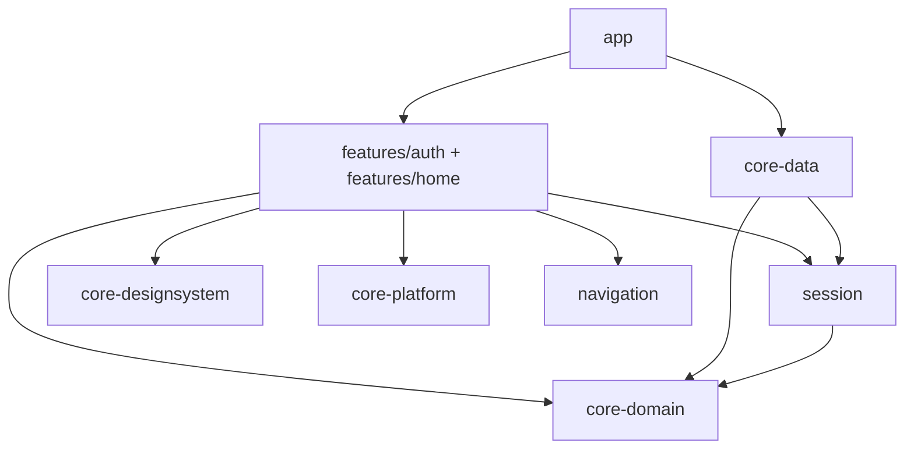

# Android Base

Proyecto inicial extraído de los patrones de CvFree, con **exactamente dos features de ejemplo: `auth` y `home`**. La base ejecutable conserva Kotlin, Compose, Material 3, arquitectura por capas, módulos Gradle, Koin Annotations/KSP, rutas tipadas, coroutines, DataStore e infraestructura Firebase/HTTP.

## Empezar en cinco pasos

1. Extrae `AndroidBase/` en una carpeta propia. Abre **esa carpeta** en Android Studio, no el repositorio CvFree.
2. Selecciona JDK 21 como Gradle JDK e instala el SDK indicado en `buildSrc/src/main/kotlin/Config.kt` (compileSdk 37).
3. Sincroniza Gradle. Android Studio crea tu `local.properties`; no contiene rutas de la computadora donde se generó la base.
4. Selecciona la variante **devDebug** y ejecuta `app`.
5. Pulsa **Explorar demo**, guarda ejemplos, cambia el tema y cierra sesión. Puedes empezar a sustituir las features sin configurar un backend.

```powershell
.\gradlew.bat :app:assembleDevDebug
.\gradlew.bat :app:installDevDebug
```

En macOS/Linux: `chmod +x gradlew` y usa `./gradlew`. Necesitas acceso a repositorios de dependencias y los componentes Android SDK correspondientes. La biblioteca de skills está incluida en `skills/`; consulta su `README.md` para elegir la que corresponda.

## Qué funciona inicialmente

| Capacidad | Estado |
| --- | --- |
| Auth demo | Entrada explícita sin cuenta ni credenciales; sesión temporal en memoria |
| Home demo | Lista y guardado local con DataStore; datos conservados al reiniciar |
| Apariencia | Tema claro/oscuro persistente y compartido por toda la app |
| Idiomas | Español por defecto e inglés según idioma del dispositivo |
| Navegación | Rutas serializables; cambia de grafo por identidad y elimina la UI protegida al salir |
| Estado | UiState + intenciones con ViewModel, StateFlow y lifecycle |
| DI | Koin, anotaciones, KSP, módulos por feature y composición en Application |
| Firebase | Adaptadores reales Auth/Firestore, App Check por build type, Analytics, Crashlytics y Remote Config, activables con propiedad |
| HTTP | OkHttp + Retrofit registrados en DI, sin solicitudes a un servicio ficticio |
| Backend | Callable autenticada de ejemplo, reglas completas, índices y pruebas |
| Entrega | Variantes dev/prod, firma externa, R8, CI y scripts de comprobación |

En modo demo no se inicializa Firebase y no hay telemetría remota. La sesión demo no valida credenciales, no crea cuentas ni envía correos. Todos los accesos demo usan el mismo espacio local `demo`, destinado únicamente a exploración. Los ejemplos locales no se migran automáticamente a Firebase.

## Arquitectura y módulos

```text
app                      Composición, Application, Activity y MainGraph
features/auth            Entrada demo; login, registro y recuperación Firebase
features/home            Lista, creación de ejemplos y preferencia de tema
core-domain              Entidades, resultados, contratos y AddExampleUseCase
session                  Contrato de identidad y estados de sesión, Kotlin puro
core-data                DataStore, Firebase, adaptadores y configuración Retrofit
core-platform            BaseViewModel y contrato de observabilidad
core-designsystem        Tema Material 3, colores y tipografía
navigation               AuthRoute y HomeRoute serializables, Kotlin puro
buildSrc                 Convenciones de app, librería Android/Kotlin y feature
firebase                 Functions, reglas completas y pruebas de reglas
skills                   Las skills de guía para extender el proyecto
```



Las features no dependen de `core-data` ni entre sí. El dominio y los contratos de sesión no importan Android/Firebase/Koin. La capa de datos convierte excepciones en resultados y propaga cancelación. El flujo protegido obtiene el UID desde la sesión real; no desde un argumento externo. Las reglas del servidor siguen siendo la autoridad de acceso.

## Inicializacion de Koin

`AndroidApplication.onCreate` prepara Timber/Firebase segun la configuracion y llama a `koinInitializer()`. El arranque registra contexto Android, logger y la propiedad `firebase.enabled`, y carga exclusivamente `AppModule().module`.

`AppModule` usa `@Module(includes = [CoreDataModule::class, NetworkModule::class, AuthModule::class, HomeModule::class])` y `@ComponentScan`. Los modulos de cada feature mantienen esas anotaciones; los ViewModels usan `@KoinViewModel`, y los proveedores compartidos `@Single`. Los plugins de app, datos y features aplican `plugin.koin` para generar sus definiciones con KSP.

El modo demo no resuelve los proveedores Firebase: son dependencias diferidas y protegidas por la configuracion. `SessionLifecycle` conserva la limpieza del listener Auth al cerrar Koin, mediante una extension registrada despues del arranque. Esta base no modifica archivos generados ni combina registros DSL con los de anotaciones.

El registro de esa extension queda aislado en `koinInitializer` con `@OptIn(KoinInternalApi::class)`, requerido por el ExtensionManager de Koin 4.2.2. Al cambiar esa version debe revisarse este punto de lifecycle; no se elimina el cierre del listener para adaptar la sintaxis de DI.

## Sustituir las dos features

Para la primera iteración puedes conservar los nombres `auth` y `home` y cambiar sus pantallas, estado y reglas.

1. Define modelos, contratos y reglas en `core-domain`; implementa proveedores en `core-data`.
2. Cambia `LoginUiState/LoginUiIntent/LoginError/LoginViewModel` en `auth/ui/login/` o `HomeUiState/HomeUiIntent/HomeViewModel` en `home/ui/home/` según el flujo. Cada tipo de nivel superior tiene su propio archivo; el ViewModel contiene únicamente su lógica. Conserva el aislamiento de SDKs.
3. Actualiza recursos de cada feature y crea componentes compartidos en `core-designsystem` cuando sean reutilizables.
4. Expón destinos desde `navigation` y registra los grafos desde `app/MainGraph.kt`.
5. Si agregas una feature nueva, aplica `plugin.feature`, define namespace y crea su módulo anotado. Regístrala en `settings.gradle.kts`, dependencias de `app` y `AndroidApplication`.
6. Actualiza o sustituye los ejemplos y sus pruebas. No hay módulos de CV, plantillas de currículum ni datos del proyecto original.

La autenticación ejemplifica orquestación simple sobre el contrato de sesión. Añade casos de uso específicos si aparecen reglas de registro, perfil, permisos o múltiples pasos. `AddExampleUseCase` muestra validación de negocio fuera del ViewModel.

### Archivos por pantalla

```text
features/auth/.../features/auth/
  AuthGraph.kt
  AuthModule.kt
  ui/login/
    LoginScreen.kt
    LoginViewModel.kt
    LoginUiState.kt
    LoginUiIntent.kt
    LoginError.kt
features/home/.../features/home/
  HomeGraph.kt
  HomeModule.kt
  ui/home/
    HomeScreen.kt
    HomeViewModel.kt
    HomeUiState.kt
    HomeUiIntent.kt
```

Los nombres de clase coinciden con los archivos y usan el prefijo de su pantalla. `LoginError` traduce los fallos de dominio para la UI de acceso. Las intenciones conservan sus variantes anidadas dentro del contrato sealed. Las pruebas siguen los paquetes `ui/login` y `ui/home`. La base Home conserva su ejemplo de lista; no necesita el contrato `HomeContent` del dashboard de PagoControl.

## Identidad y versiones del nuevo producto

- Nombre de proyecto: `settings.gradle.kts`.
- Nombre visible: recursos de `app/src/main/res/values/strings.xml` y `app/src/dev/res/values/strings.xml`.
- ID y namespace: `app/build.gradle.kts`; los namespaces de las librerías se definen en sus builds. Usa refactorización de paquetes de Android Studio para cambiar `com.example.androidbase` en todo el código.
- SDK/JDK: `buildSrc/src/main/kotlin/Config.kt`.
- Versiones de librerías/plugins: `gradle/libs.versions.toml`. Las de buildSrc se obtienen del mismo catálogo.
- Versión del producto: `app.versionCode` y `app.versionName` en `gradle.properties` o propiedades CI.
- API propia: `api.baseUrl` debe ser HTTPS y terminar en `/`. El valor `https://example.invalid/` es deliberadamente inactivo. Agrega tus interfaces Retrofit y registra servicios cuando exista un contrato real.

El toolchain se basa en el del repositorio de origen: Gradle 9.7.1, AGP 9.3.2, Kotlin 2.4.10 y Java 21. Se usa Kotlin integrado de AGP para módulos Android y plugin JVM para módulos puros. No se copian dependencias Firebase KTX antiguas: Firebase usa BOM y artefactos principales.

## Conectar tu Firebase

1. Crea proyectos Firebase propios para desarrollo y producción y habilita Email/Password en Auth y una base Firestore.
2. Registra `com.example.androidbase.dev` para dev y `com.example.androidbase` para prod, o tus IDs definitivos.
3. Coloca cada archivo descargado en `app/src/dev/google-services.json` y `app/src/prod/google-services.json`. No se distribuye un archivo ficticio ni uno de CvFree.
4. Ejecuta `:app:assembleDevDebug -Pfirebase.enabled=true`. Para activarlo siempre en tu copia, cambia `firebase.enabled=true` en `gradle.properties`.
5. Publica las reglas de **tu proyecto nuevo** desde `firebase/` con proyecto explícito, después de ejecutar las pruebas. Revisa e integra antes de desplegar si tu base ya tiene datos o reglas propios.
6. Registra App Check: proveedor Debug para debug y Play Integrity para release. Registra el token debug local sin compartirlo. Habilitar enforcement en consola es una configuración externa.
7. Verifica login, registro, recuperación y aislamiento entre dos UIDs. La lista cambia a Firestore al activar Firebase; el modo cloud nunca cae silenciosamente a demo si el servicio falla.

`firebase.enabled` es una opción **de build**, no un selector de cuenta ni un permiso. Sus archivos Firebase deben coincidir con el ID de cada variante que compiles. En debug Analytics y Crashlytics quedan desactivados por defecto; release los activa cuando se habilita Firebase. Ajusta esta política a las decisiones de privacidad/consentimiento de tu producto antes de distribuir.

Remote Config incluye fetch y el default `example_enabled=true` como infraestructura; ninguna regla de negocio depende todavía de ese parámetro. Crashlytics captura fallos no controlados cuando se activa; los errores controlados del ejemplo envían únicamente un código de operación a Analytics. No se registran correos, contraseñas ni títulos.

## Variantes

| Variante | ID | Uso |
| --- | --- | --- |
| devDebug | `com.example.androidbase.dev` | Desarrollo local y pruebas |
| devRelease | `com.example.androidbase.dev` | Comprobar optimización en desarrollo |
| prodDebug | `com.example.androidbase` | Diagnóstico con configuración de prod propia |
| prodRelease | `com.example.androidbase` | Candidato de distribución |

Las librerías no duplican sabores que no usan. Se retira la dimensión Free/Premium porque el nuevo producto todavía no tiene planes comerciales. Si la necesitas, consulta la skill de Gradle y define una matriz explícita.

## Pruebas y CI

```powershell
.\gradlew.bat :core-domain:test :core-data:testDebugUnitTest :features:auth:testDebugUnitTest :features:home:testDebugUnitTest
.\gradlew.bat :app:lintDevDebug :app:assembleDevDebug :app:compileDevDebugAndroidTestKotlin
.\gradlew.bat :app:connectedDevDebugAndroidTest
npm --prefix firebase/functions ci
npm --prefix firebase/functions test
npm --prefix firebase/rules-tests ci
npm --prefix firebase/rules-tests test
```

Las instrumentadas necesitan un emulador/dispositivo conectado; las pruebas de reglas necesitan Java 21 y Emulator Suite. Las pruebas unitarias backend no prueban por sí solas Auth/App Check desplegados. `.github/workflows/verify.yml` automatiza build/lint/pruebas locales y reglas en GitHub Actions; no publica ni incorpora secretos de producción. La ejecución remota se comprueba después de subir tu repositorio.

Consulta `docs/VALIDATION.md` para el resultado real de las comprobaciones realizadas al generar este paquete. No confundas una tarea definida con una tarea ejecutada.

## Firma y despliegue

Copia `keystore.properties.example` como `keystore.properties` en tu copia y completa rutas/contraseñas locales. Las claves y propiedades están excluidas de Git y del empaquetado. Sin esa configuración se pueden compilar builds release sin firma de distribución; no están listos para subir a Play.

```powershell
.\gradlew.bat :app:bundleProdRelease -Pfirebase.enabled=true
```

Generar el AAB no lo publica. Configura Google Play Console, firma y políticas de tu producto antes de entregar. Para Firebase consulta `firebase/README.md`. No se han creado proyectos, cuentas, claves, secretos, productos comerciales ni despliegues externos con esta plantilla.

## Capacidades opcionales del proyecto original

PDF/OCR, IA, Billing y push tienen skills específicas incluidas, pero no se activan como funcionalidades de estas dos features genéricas. Integra cada una cuando su contrato de producto esté definido; copiar IDs de suscripción, cupos o prompts de CvFree introduciría reglas ajenas al nuevo negocio. Los adaptadores de infraestructura incluidos están descritos con su estado real en la tabla inicial.

## Referencias de compatibilidad

- [Kotlin integrado en AGP](https://developer.android.com/build/migrate-to-built-in-kotlin).
- [Firebase BOM y módulos Kotlin](https://firebase.google.com/docs/android/learn-more).
- [Koin Annotations](https://insert-koin.io/docs/reference/koin-annotations/start/).
